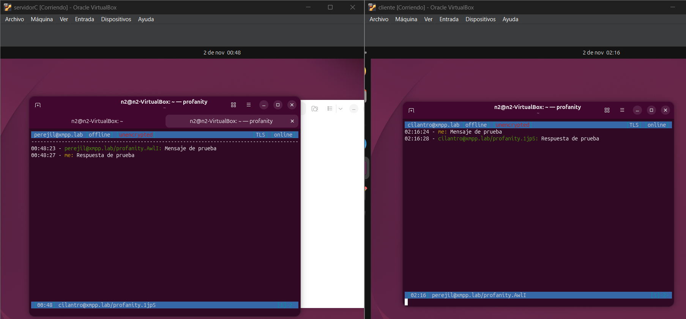

# Tarea-2: Análisis del protocolo XMPP
Este proyecto consiste en el uso del protocolo XMPP, el cual es un protocolo orientado a la mensajería instantánea, para hacerlo se genero una conexión cliente-servidor local para analizar el trafico que se genera, comparando el trafico resultante en comparación al teórico, analizando sus diferencias y el motivo de estas.

# Tabla de contenidos

- [Información general](#Información-general)
- [Tecnologias usadas](#Tecnologias-usadas)
- [Caracteristicas](#Caracteristicas)
- [Capturas de pantalla](#Capturas-de-pantalla)
- [Setup](#Setup)
- [Uso](#Uso)
- [Estado del proyecto](#Estado-del-proyecto)
- [Espacio de mejora](#Espacio-de-mejora)
- [Agradecimientos](#Agradecimientos)
- [Contacto](#Contacto)

# Información general 

El proyecto consiste en utilizar el protocolo xmpp, el cual es un protocolo orientado a la mensajeria en tiempo real, para esto utilizaremos un cliente y un servidor, para hacer esto se usara ejabberd como el servidor, mientras que profanity como el cliente. 

Para la realización de este trabajo utilizaremos dos maquinas virtuales con ubuntu como sistema operativo, una maquina virtual cumplirá de servidor y cliente y otra de exclusivamente cliente, el propósito de este proyecto es analizar y comprender el funcionamiento del protocolo.

Para la recolección de paquetes y por ende poder realizar el análisis del protocolo, se utilizara wireshark, con este programa se podra comparar el funcionamiento teorico con el practico.

# Tecnologias usadas

-Ubuntu 

-Oracle virtualbox

-Ejabberd

-Profanity

-Wireshark

# Caracteristicas

-Envió de mensajería instantanea

-Local

-Mensajes guardados en el servidor

-Seguridad con tls

# Capturas de pantalla

# Setup

Las maquinas virtuales utilizadas para este informe fueron creadas para este trabajo sin uso previo, por lo que para realizarlo, se instalaron utilidades aparte de las estrictamente necesarias que serian ejabberd, profanity y wireshark, los pasos de instalación fueron los siguientes:

Se utilizo sudo apt update, para refrescar el índice local de paquetes en sistemas operativos basados en Debian y Ubuntu, luego con sudo apt upgrade se actualizaron dichos paquetes.

Se instalo el servidor ejjaberd con sudo apt install ejabberd. Considerar que este comando es el único exclusivo de la maquina virtual servidor.

Se instalo el cliente profanity con sudo apt install profanity en ambas maquinas virtuales.

Se instalo wireshark con sudo apt install wireshark para la captura del trafico generado.

Se instalaron utilidades para realizar la red en sistemas operativos linux con sudo apt install net-tools.

Se instalo netcat-openbsd con sudo apt install netcat-openbsd, principalmente para confirmar el correcto funcionamiento del puerto 5222.

Con todo correctamente instalado, para poder realizar el envió de mensajes en tiempo real, fue necesario conectar ambas maquinas virtuales a la misma red, esto se hizo de la siguiente manera:

En oracle virtualbox nos dirigimos a archivos, luego herramientas y le damos a administrador de red, dentro de ahí seleccionamos la opción crear una red host-only a la cual le desactivamos el servidor dhcp para poder asignar manualmente y que se mantengan fijas las IPs de las maquinas virtuales.

Asociamos ambos VM a la red creada, para esto seleccionamos la VM, vamos a Configuración y le damos a red, utilizaremos el adaptador numero 1,  por lo que lo seleccionamos conectado a: y buscamos adaptador solo-anfitrión. 

Esto por si solo no es suficiente para que funcione, por lo que tenemos que asignarle a las maquinas sus IPs estáticas.

Para asignarles su IP nos dirigimos a configuración, red, en la conexión cableada le damos al engranaje, en la sección de IPv4 asignamos la IP y mascara, para el caso de este informe, la IP servidor corresponde a 192.168.56.10 mascara /24, mientras la IP cliente es 192.168.56.20 mascara /24.

Para confirmar que todo este correctamente hecho, realizamos un ping desde ambas VM con: ping -c 4 192.168.56.10 desde cliente y ping -c 4 192.168.56.20 desde servidor.

Dentro de la VM servidor realizamos los siguientes pasos:

iniciamos habilitando ejabberd con sudo systemctl enable --now ejabberd, podemos también comprobar su estado con sudo systemctl status ejabberd, si todo funciona normalmente, el servidor estará corriendo (running) y activo.

Para configurar el servidor nos dirigimos a su archivo de configuración principal, al cual se accede mediante la linea /ect/ejabberd/ejabberd.yml, por lo que procedemos a modificar el archivo utilizando nano con sudo nano /etc/ejabberd/ejabberd.yml, dentro de este archivo buscamos la sección host:, donde están los dominios que se utilizan para el servidor, creamos un dominio con el nombre "xmpp.lab", guardamos y cerramos el archivo, con eso realizado reiniciamos el servidor utilizando sudo systemctl restart ejjaberd.

Como nuestra mensajería utilizara el puerto 5222 con sudo ss -lntp | grep 5222 podremos identificar qué programa o servicio está escuchando conexiones en el puerto TCP 5222, por lo mismo para despejar posibles problemas futuros permitimos manualmente las conexiones al puerto 5222 con sudo ufw allow 5222/tcp.

Con esto ya podemos crear/registrar nuestros usuarios xmppp utilizando sudo ejabberdctl register -nombre -dominio -clave, para efectos de este trabajo utilizaremos el dominio ya creado xmpp.lab, mientras que los usuarios creador serán cilantro y perejil, ambos con la contraseña clave123. Para confirmar que están correctamente creados, usamos sudo ejabberdctl registered$_users xmpp.lab$ para ver la lista de usuarios.

Dentro de la VM cliente realizamos los siguientes pasos:

Primero partimos configurando la resolución de dominio, esto los haremos accediendo al archivo con sudo nano /etc/hosts, dentro de este agregamos la IP del servidor y el dominio, quedándonos como resultado 192.168.56.10 xmpp.lab, guardamos y cerramos, para comprobar la resolución podemos utilizar getent host xmpp.lab. En caso de querer enviar mensaje desde la maquina virtual servidor es necesario realizar estos pasos también.

Podemos comprobar el puerto del servidor utilizando nc -vz xmpp.lab 5222, con esta linea intentaremos hacer conexión con el puerto del servidor, si todo esta funcionando correctamente, la conexión sera exitosa.

Con estos pasos realizados exitosamente ya es posible realizar el envió de mensajes utilizando profanity, lo cual sera revisado en la sección: uso de los software.

# Uso

Con los pasos anteriores realizados, podemos establecer conexión al servidor para comenzar el envió de los mensajes, los pasos para realizar esto desde 0 serian los siguientes: 

Iniciamos ejabberd en la VM servidor utilizando sudo systemctl enable --now ejabberd, asumiendo que todo funcione correctamente Abrimos profanity escribiendo profanity, esto puede realizarse con ambas VM o solo VM cliente.

Dentro de profanity nos conectamos a uno de los dos usuarios creador previamente, esto lo haremos usando /connect nombredeusuario@dominio, por ejemplo con perejil quedaría lo siguiente: /connect perejil@xmpp.lab, al ingresar la linea nos pedirá la contraseña, al introducirla, profanity mostrara que la conexión se encuentra activa, con ello ahora podremos enviar mensajes a los usuarios registrados, bien a nosotros mismos (perejil) o a cilantro, para enviar mensajes utilizamos /msg nombreusuario@dominio mensaje.

# Estado del proyecto

Actualmente se encuentra en progreso, se ha logrado establecer la conexion, envios de mensajes y analisis de estos mensajes, mas este proyecto pretende en un futuro experimentar con la modificación de tráfico y el análisis de métricas.

# Espacio de mejora

Las areas que podrian mejorar podrian ser la ampliacion de la escala del proyecto, probando con una red mas amplia de usuarios y separados entre si. Tambien se puede expandir el proyecto con la modificación de tráfico y el análisis de métricas, la cual es el siguiente objetivo del proyecto.

# Agradecimientos

Agradecimientos a Jonas Peñailillo por la presentacion de la idea del proyecto.

Agradeciemtos a Maria Martinez por la revision del proyecto.

Muchas gracias por apoyo moral hacia Infired y Dynasty.

# Contacto

Creado por Nicolas Guajardo

Correo: nicolas.guajardo1@mail.udp.cl
